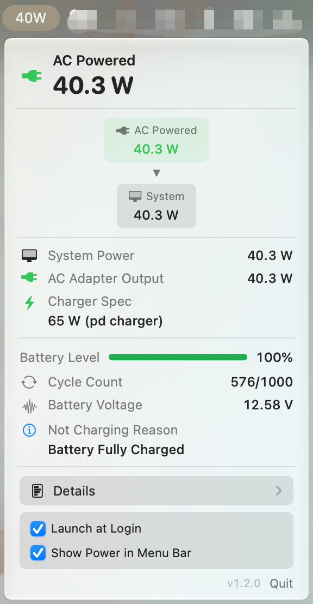
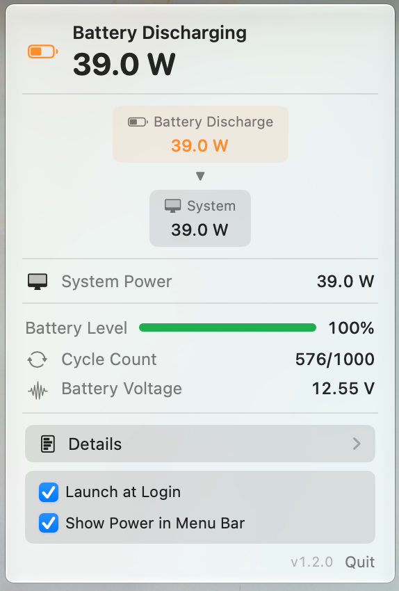
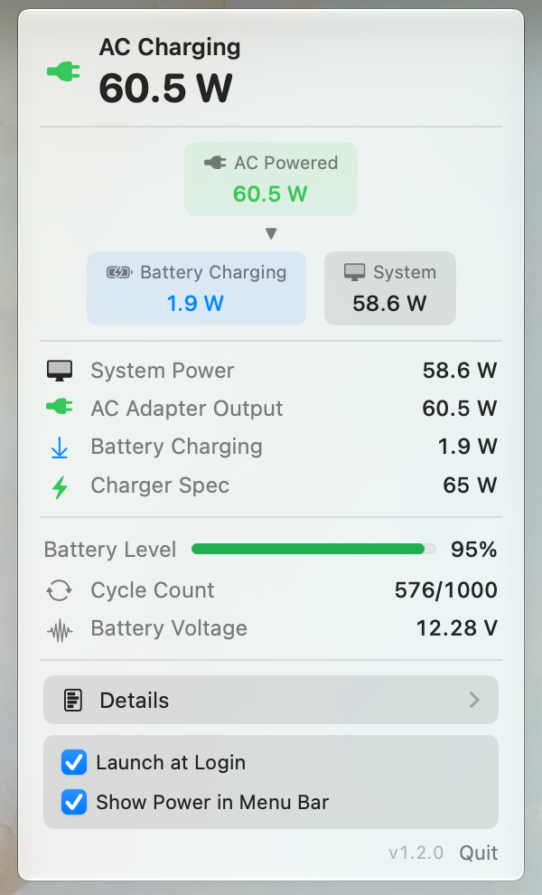
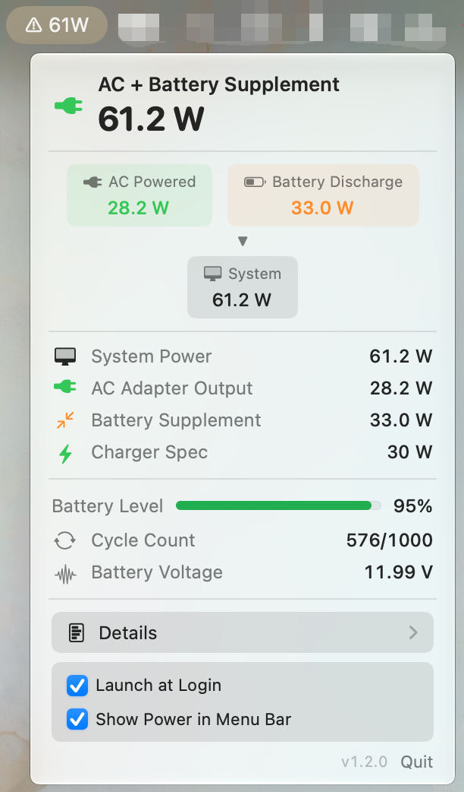
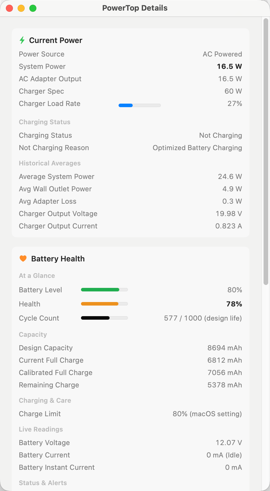
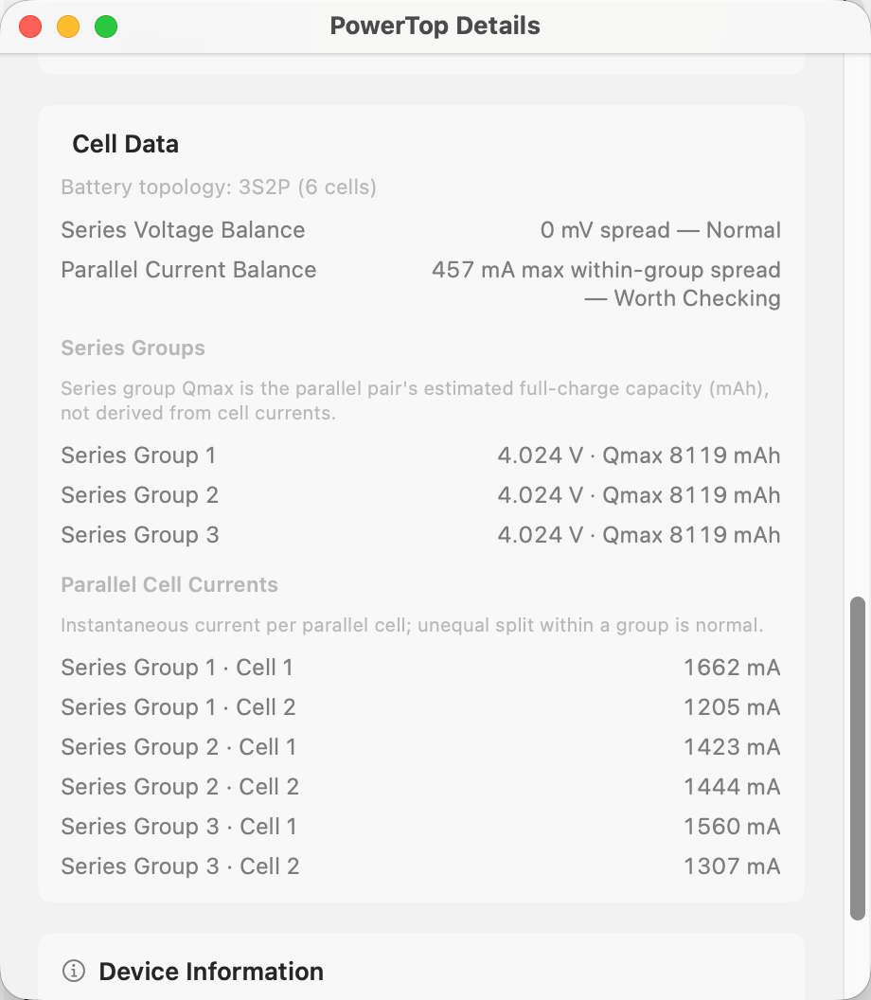

# PowerTop

**English** | **[简体中文](README.zh-CN.md)**

A clean, lightweight menu bar app that shows you exactly how much power your MacBook is using.

<p align="center">
  
  
  
  
</p>

> **MacBook only** — Requires a Mac with a built-in battery (Apple Silicon MacBook).

## Finally Know How Much Power You're Using

macOS never tells you the actual watts your MacBook is consuming right now. PowerTop changes that.

It gives you clear, real-time power information directly in the menu bar and a simple popover — so you can see exactly what's happening with power on your machine.

<p align="center">
  
  &nbsp;&nbsp;
  
</p>

<p align="center">
  <sub>Menu bar power overview · Detailed battery and power parameters</sub>
</p>

## Key Features

- **Optional menu bar wattage** — Show live power like `23W` right in the menu bar when you want it.
- **Power flow diagram** — See at a glance whether power is coming from the charger, the battery, or both at the same time.
- **Instant power numbers** — System power, charger output, and battery charge or discharge rate.
- **Charger load** — Know your adapter's wattage and how much of it is being used.
- **Battery overview** — Quick view of battery level, health, temperature, and cycle count.
- **Estimated battery time** — Time to empty or full in the popover and detail view; respects macOS charge limits (80/85/90/95%) and third-party apps like AlDente.
- **Detailed information** — Auto-detected cell topology (e.g. 3S2P), series-group voltage, parallel cell currents, charging status, and lifetime stats.

Everything updates live and stays accurate even when you plug in or unplug your charger.

## Why People Use PowerTop

- Curious about real power consumption on their MacBook
- Want to know if their charger is powerful enough during heavy work
- Like seeing when the battery is helping supply power
- Want a simple, beautiful way to monitor battery health and charging behavior

It's a small, native app that does one thing well — no bloat, no subscriptions.

## Installation

### Download (Recommended)

Download the latest `PowerTop.zip` from the [Releases](https://github.com/kDolphin/PowerTop/releases) page:

1. Unzip the file
2. Drag `PowerTop.app` into your `/Applications` folder
3. First launch: right-click the app → **Open** (the app is not signed)

### Build from Source

```bash
git clone https://github.com/kDolphin/PowerTop.git
cd PowerTop
bash build.sh
open build/PowerTop.app
```

## Requirements

- Apple Silicon MacBook (M-series)
- macOS 14 (Sonoma) or later

## How to Use

1. Open PowerTop — the icon appears in your menu bar.
2. Click the icon to open the popover with the power flow diagram and current readings.
3. Turn on **Show Power in Menu Bar** at the bottom if you want the wattage always visible.
4. Click **Details** for a full breakdown of power and battery information.

## Screenshots

### Popover

| **AC Powered** | **Battery Discharging** |
|----------------|--------------------------|
| <a href="screenshot/popover-ac-powered.png" target="_blank"></a> | <a href="screenshot/popover-battery-discharging.png" target="_blank"></a> |

| **AC Charging** | **AC + Battery Supplement** |
|-----------------|------------------------------|
| <a href="screenshot/popover-ac-charging.png" target="_blank"></a> | <a href="screenshot/popover-ac-supplement.png" target="_blank"></a> |

### Detail Window

| **Power & Battery Health** | **Cell Data** |
|----------------------------|---------------|
| <a href="screenshot/detail-window-health.png" target="_blank"></a> | <a href="screenshot/detail-window-cells.png" target="_blank"></a> |

## What's New

### v1.3.3

- **Charge-limit-aware estimates** — Time-to-full now targets your effective charge limit (macOS Settings, AlDente, or Optimized Charging hold) instead of always assuming 100%
- **Smarter limit detection** — Ignores stale AlDente configs when `useTahoeNativeLimit` is enabled; only uses Optimized Charging `DailyMaxSoc` when the pause flag is active

### v1.3.2

- **Battery health fix** — Reads design capacity, full charge, and health % from `BatteryData` on Apple Silicon; reorganized detail view with aligned overview bars and clearer capacity labels
- **Compact detail window** — Fixed 460pt width for a tighter layout

### v1.3.1

- **Adaptive cell topology** — Detects each MacBook's actual S×P layout from IOKit (e.g. 2S2P on Air, 3S2P on Pro); no hardcoded topology

### v1.3.0

- **Estimated battery time** — Computes time to empty or full from remaining energy and smoothed power when macOS stops reporting `AvgTimeToEmpty` / `AvgTimeToFull`; shown in popover and detail view
- **Cell data fix (Apple Silicon)** — Reads per-series-group voltage/Qmax and per-parallel-cell current from IOKit bank/cell nodes; topology is detected per machine
- **Clearer cell balance** — Separate series voltage balance and parallel current balance
- **Detail window polish** — Fixed duplicate rows, moved manufacture date to device info, improved labels

### v1.2.0

- Redesigned detail window, flat layout, instant menu bar updates after wake, 0 W idle fix, cell balance summary

[Older releases →](https://github.com/kDolphin/PowerTop/releases)

## License

MIT License. See [LICENSE](LICENSE) for details.

---

## 中文说明

一个原生 macOS 菜单栏应用，用于 Apple Silicon MacBook 的实时功耗监控。

> **⚠️ 仅支持 MacBook** — PowerTop 需要内置电池。Mac mini、Mac Studio、Mac Pro 不受支持。

### 功能特性

- **实时功率流向图** — 可视化 AC 适配器、电池和系统之间的功率流向
- **瞬时功率指标** — 系统功耗、AC 适配器输出、电池充放电功率
- **电池健康** — 健康度百分比、循环次数、设计容量、温度
- **详细参数** — 电芯数据、充电详情、生命周期统计
- **电源变更通知** — 插拔电源即时刷新界面
- **双语支持** — 中文和英文，跟随系统语言
- **开机启动** — 可选登录时自动启动
- **原生 macOS 体验** — SwiftUI 构建，菜单栏应用，无 Dock 图标

### 安装

从 [Releases 页面](https://github.com/scavin/PowerTop/releases) 下载 `PowerTop.dmg`。

1. 打开 `PowerTop.dmg`，将 **PowerTop** 拖入 **Applications（应用程序）**。
2. 在 Finder 中打开"应用程序"，双击 **PowerTop** 启动一次。看到 macOS
   无法验证该 App 的提示后，关闭提示。
3. 打开**系统设置 → 隐私与安全性**，向下滚动到"安全性"。
4. 找到"已阻止'PowerTop'以保护 Mac"，点击**仍要打开**。
5. 使用 Touch ID 或登录密码验证，然后确认**打开**。以后可以正常双击启动。

PowerTop 已进行 ad-hoc 签名，但因为项目没有 Apple Developer 账号而无法进行
Apple 公证，所以上述 Gatekeeper 放行操作首次启动时属于预期行为。极少数情况下
点击**仍要打开**后依然失败，请在应用已移入 `/Applications` 后执行一次：

```bash
xattr -cr /Applications/PowerTop.app
```

### 从源码构建

```bash
git clone https://github.com/scavin/PowerTop.git
cd PowerTop
bash build.sh
open build/PowerTop.app
```

### 功率计算逻辑

- **AC 充电时**：系统功耗 = `SystemPowerIn` - 充电功率（AC 输入减去向电池供电的部分）
- **电池供电时**：系统功耗 = `BatteryPower`（放电功率 = 系统消耗）
- **充电功率**：使用 `abs(Amperage) × Voltage / 1,000,000` 计算，比 BatteryPower 更准确
