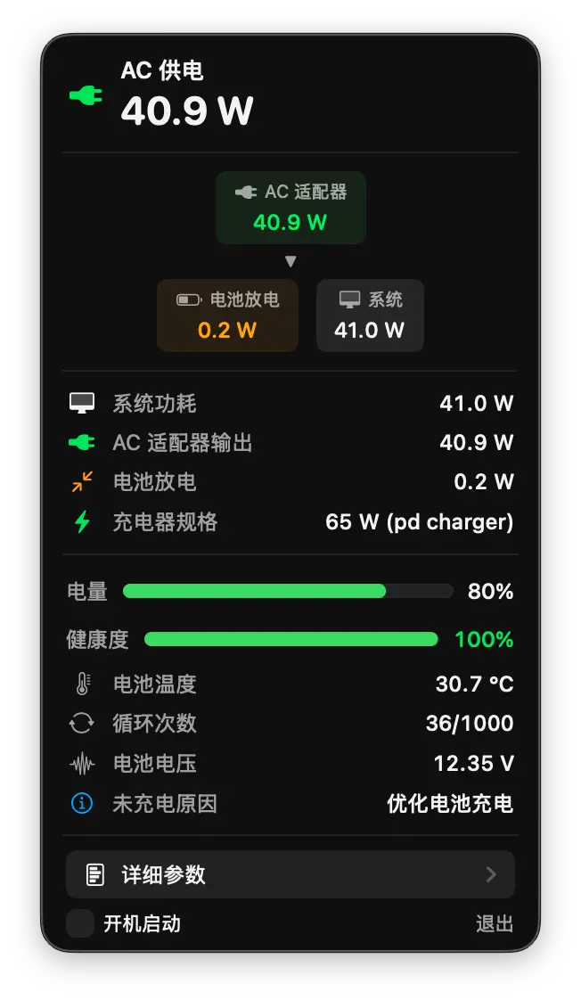
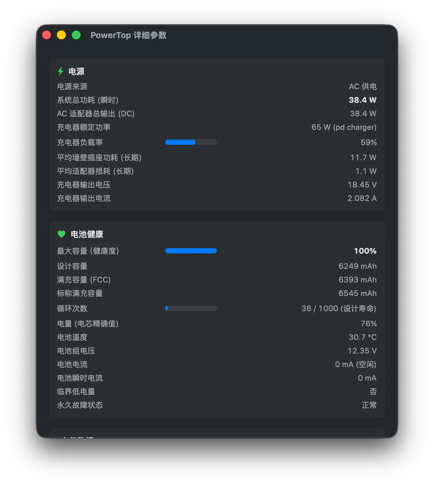

# PowerTop

A native macOS menu bar app for real-time power monitoring on Apple Silicon MacBooks.

> **⚠️ MacBook only** — PowerTop requires a built-in battery. Mac mini, Mac Studio, and Mac Pro are not supported.

<p align="center">
  
  
  
</p>

## Features

- **Real-time Power Flow Diagram** — Visualize how power flows between AC adapter, battery, and system
- **Instant Power Metrics** — System power consumption, AC adapter output, battery charge/discharge rate
- **BatteryView Menu Bar Icon** — Original proportional battery drawing and an immediate AC connection bolt, without entrance animation
- **Optional Menu Bar Power** — Enable the power checkbox and choose system consumption, adapter total input, battery net power, or automatic mode in the adjacent dropdown. Battery net power uses `+` for charging and `−` for discharging. Automatic mode shows adapter input during charging and system load otherwise. The display is off by default and remembers the selection; inferred values use `≈`. The gear menu offers optional 99 W display capping and supply warnings; the tooltip always retains the full value.
- **Battery Time Estimates** — Prefer valid system estimates; otherwise use remaining energy and smoothed battery power. Estimates respect macOS/active AlDente charge limits and stop while power readings conflict.
- **Battery Topology and History** — Read pack/bank/cell nodes, show series-group voltage/Qmax, available parallel-cell currents and balance summaries, controller lifetime statistics, and validated manufacture dates. Missing fields stay hidden.
- **Battery Health** — Health percentage, cycle count, design capacity, temperature
- **Detailed Parameters** — Deep dive into battery cell data, charging details, lifetime statistics
- **Power Source Notifications** — Instant UI refresh when AC is plugged/unplugged
- **Bilingual Support** — English & Chinese (Simplified), follows system language
- **Launch at Login** — Option to start automatically on login
- **Native macOS Experience** — Built with SwiftUI, menu bar app with no dock icon

## Screenshots

<p align="center">
  
  &nbsp;&nbsp;
  
</p>

<p align="center">
  <sub>Menu bar power overview · Detailed battery and power parameters</sub>
</p>

## Requirements

- macOS 14.0 (Sonoma) or later
- Apple Silicon **MacBook** (battery required — Mac mini / Mac Studio / Mac Pro not supported)

## Installation

### Download

Download `PowerTop.dmg` from the [Releases page](https://github.com/scavin/PowerTop/releases).

1. Open `PowerTop.dmg` and drag **PowerTop** to the **Applications** folder.
2. In Finder, open **Applications** and launch **PowerTop** once. When macOS
   reports that it cannot verify the app, close the warning.
3. Open **System Settings → Privacy & Security** and scroll down to **Security**.
4. Next to the message that **PowerTop was blocked to protect your Mac**, click
   **Open Anyway**.
5. Authenticate with Touch ID or your password, then confirm **Open**. Future
   launches work normally.

PowerTop is ad-hoc signed but cannot be notarized because the project does not
have an Apple Developer account, so this one-time Gatekeeper approval is
expected. In the uncommon case that **Open Anyway** still does not work, run
this once after moving the app to `/Applications`:

```bash
xattr -cr /Applications/PowerTop.app
```

### Build from Source

```bash
git clone https://github.com/scavin/PowerTop.git
cd PowerTop
bash build.sh
open build/PowerTop.app
```

## How It Works

PowerTop reads power data from macOS IOKit's `AppleSmartBattery` service, specifically the `PowerTelemetryData` dictionary which provides:

| IOKit Property | Description |
|---|---|
| `SystemLoad` | Total system power consumption |
| `SystemPowerIn` | DC power from AC adapter |
| `BatteryPower` | Battery charge/discharge power |
| `Amperage` × `Voltage` | Signed battery power: positive charging, negative discharging |

### Power Calculation Logic

- **On AC**: Calculate system consumption from input and signed battery power in the same telemetry block. Charging subtracts from input; battery discharge adds to input.
- **On battery**: Ignore stale adapter input and normalize battery discharge to positive consumption.
- **Battery direction**: Preserve the sign of `BatteryPower` and `Amperage × Voltage`. A delayed `IsCharging` flag cannot turn discharge into charge. Signed current is the fallback when battery power telemetry is missing.
- **Conflicting readings**: Display `— W` until opposite battery directions or impossible power balances resolve. An actual zero adapter input is never treated as a missing reading; inferred values for missing input carry `≈`.
- **Refresh**: The app polls every 2 seconds; macOS can update the underlying readings less frequently and at different times.

## Localization

PowerTop supports English and Simplified Chinese, automatically following your system language. You can also override the language in **System Settings → General → Language & Region → Applications**.

## License

MIT License. See [LICENSE](LICENSE) for details.

Battery icons use the original `SFSymbolStyle` and `Multicolor` configuration from
[BatteryView](https://github.com/theMomax/BatteryView) by Max Obermeier (MIT).
See [ThirdPartyNotices.txt](ThirdPartyNotices.txt).

---

## 中文说明

一个原生 macOS 菜单栏应用，用于 Apple Silicon MacBook 的实时功耗监控。

> **⚠️ 仅支持 MacBook** — PowerTop 需要内置电池。Mac mini、Mac Studio、Mac Pro 不受支持。

### 功能特性

- **实时功率流向图** — 可视化 AC 适配器、电池和系统之间的功率流向
- **瞬时功率指标** — 系统功耗、AC 适配器输出、电池充放电功率
- **BatteryView 菜单栏图标** — 保留原版比例和配色，接入外部电源即显示闪电，无入场动画；可选显示整机功耗、输入功率、电池净流入/流出或自动模式
- **剩余时间估算** — 优先使用有效系统估算，否则根据剩余能量和近期电池功率计算；识别 macOS/运行中的 AlDente 充电上限，读数冲突时隐藏估算。
- **电芯与历史数据** — 读取电池包、串联组和电芯节点，显示真实分组的电压/Qmax、可用的并联电流及均衡摘要、生命周期统计和有效制造日期；不显示缺失数据。
- **显示选项** — 功率复选框旁选择数值类型；底部齿轮菜单可选 99 W 数字封顶和供电警告，默认关闭，完整功率仍可悬停查看。
- **电池健康** — 健康度百分比、循环次数、设计容量、温度
- **详细参数** — 电芯数据、充电详情、生命周期统计
- **电源变更通知** — 插拔电源即时刷新界面
- **双语支持** — 中文和英文，跟随系统语言
- **开机启动** — 可选登录时自动启动
- **原生 macOS 体验** — SwiftUI 构建，菜单栏应用，无 Dock 图标

### 安装

从 [Releases 页面](https://github.com/scavin/PowerTop/releases) 下载 `PowerTop.dmg`。

1. 打开 `PowerTop.dmg`，将 **PowerTop** 拖入 **Applications（应用程序）**。
2. 在 Finder 中打开“应用程序”，双击 **PowerTop** 启动一次。看到 macOS
   无法验证该 App 的提示后，关闭提示。
3. 打开**系统设置 → 隐私与安全性**，向下滚动到“安全性”。
4. 找到“已阻止‘PowerTop’以保护 Mac”，点击**仍要打开**。
5. 使用 Touch ID 或登录密码验证，然后确认**打开**。以后可以正常双击启动。

PowerTop 已进行 ad-hoc 签名，但因为项目没有 Apple Developer 账号而无法进行
Apple 公证，所以上述 Gatekeeper 放行操作首次启动时属于预期行为。极少数情况下
点击**仍要打开**后依然失败，请在应用已移入 `/Applications` 后执行一次：

```bash
xattr -cr /Applications/PowerTop.app
```

### 从源码构建

```bash
git clone https://github.com/scavin/PowerTop.git
cd PowerTop
bash build.sh
open build/PowerTop.app
```

### 功率计算逻辑

- **接入 AC 时**：使用同一组遥测中的输入功率和有符号电池功率计算系统功耗；电池充电时从输入中扣除，电池补充供电时加上放电功率。
- **电池供电时**：忽略残留的适配器输入，将电池放电功率统一表示为正的系统消耗。
- **充放电方向**：保留 `BatteryPower` 和 `Amperage × Voltage` 的正负号，滞后的 `IsCharging` 标志不能将放电变为充电。缺少电池功率遥测时才回退到有符号电流计算。
- **读数冲突时**：充放电方向相反或功率关系不成立时，暂时显示 `— W`，一致后自动恢复。实际输入为 0 W 不会被当作缺失值；缺失输入的推算值带有 `≈`。
- **刷新间隔**：应用每 2 秒读取一次，macOS 底层字段的更新可能更慢，也可能不同步。

Upstream synchronization details / 上游同步记录: [docs/upstream-sync.md](docs/upstream-sync.md).
